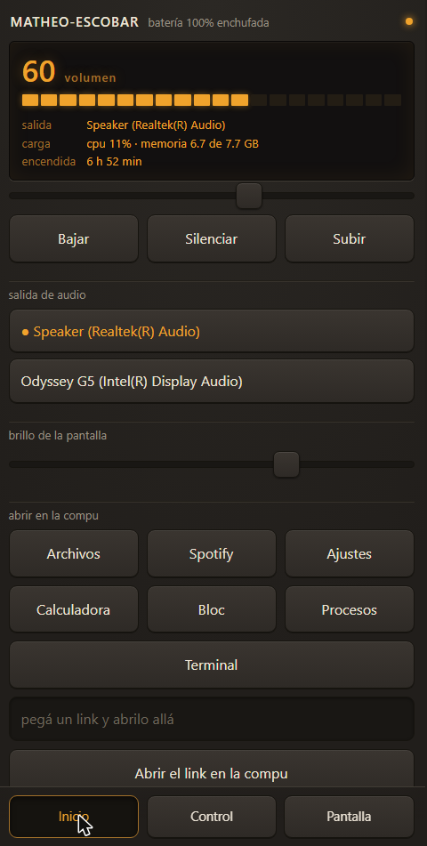

# Telemando

Un control remoto para tu propia computadora, desde el navegador del teléfono y
por la red local. Sin cuenta, sin servidor en la nube, sin dependencias: Node
con la biblioteca estándar y un proceso de PowerShell que mueve el mouse, manda
teclas y saca capturas.

Windows 10/11 y Node 18 o más nuevo. Nada más.



## Arrancarlo

```
node server.js
```

Imprime un link como `http://192.168.0.13:7070/?t=1a2b3c…` y lo deja copiado en
el portapapeles. Mandátelo por donde te quede cómodo y abrilo en el teléfono: el
token queda guardado ahí y el link sirve para siempre, porque de este lado vive
en `token.txt`. La primera vez Windows va a pedir permiso de firewall para Node
en la red privada: aceptalo.

Para tenerlo como app: en Safari, Compartir → Agregar a pantalla de inicio; en
Chrome, el menú → Agregar a pantalla principal. **Safari le da a cada app de la
pantalla principal su propio almacenamiento**, así que la app arranca sin el
token que guardaste en el navegador y pide vincularse: pegale ahí adentro el
mismo link, una sola vez.

| | |
|---|---|
| `node server.js` | normal, HTTP |
| `node server.js --https` | genera un certificado propio y sirve por TLS |
| `node test.js` | el chequeo: token, filtro de órdenes, cáscara pública |
| `node test-motor.js` | el otro chequeo, lento: matar el PowerShell no debe tumbar el servidor |
| `powershell -File icons.ps1` | redibuja los íconos de la app |
| `powershell -File autostart.ps1` | que arranque con Windows (`-Off` lo saca, `-Https` en TLS) |

Con `--https` el certificado lo firma la propia máquina, así que el teléfono
avisa que no lo conoce y hay que aceptarlo a mano una vez. Sirve para que nadie
en el mismo wifi lea el token; en una red de confianza, HTTP alcanza.

## Qué hace

**Inicio** — volumen con deslizador y el valor real de Windows, silencio,
elegir la salida de audio entre las que haya (parlantes, monitor, auriculares),
el brillo de cada pantalla por separado (el panel de una notebook y también
los monitores de escritorio, por DDC/CI), carga de CPU y memoria, batería,
hace cuánto está prendida. Teclas para abrir apps que se editan desde el
teléfono: cualquier app del menú inicio, tiendas incluidas (Apple Music en vez
de Spotify, por ejemplo); quedan guardadas en `botones.json` en la compu.
Mandar un link para que se abra allá. Ver las ventanas abiertas, traer
una al frente o cerrarla. El portapapeles en los dos sentidos. Y bloquear,
suspender, cerrar sesión, reiniciar o apagar, siempre con dos toques.

**Control** — un trackpad (arrastrar mueve, un toque es clic, dos dedos
scrollean), clic izquierdo, doble, derecho, rueda, botón sostenido para
arrastrar, teclas de reproducción, flechas, Esc/Tab/Enter/Borrar/F5, copiar,
pegar, deshacer, cambiar de ventana, menú inicio, y un campo para escribir en la
ventana que esté adelante.

**Pantalla** — la pantalla de la compu en JPEG, en bucle, con cuatro niveles de
nitidez y pausa, y el cursor marcado con un aro para no perderlo. Tocar lleva
el mouse ahí y hace clic; dos toques, doble clic; mantener apretado abre el
menú contextual. Pellizcar acerca (hasta 6×, y con zoom pide la captura
entera), un dedo arrastra, y ⛶ la pone a pantalla completa.

**Juego** — el teléfono como mando: cruceta de ocho direcciones, A B X Y, L R,
Start y Select, varias a la vez y sostenidas. Aprietan teclas del teclado con
su scan code, así las leen también los juegos que miran el teclado crudo. Dos
juegos de teclas: flechas + Z/X (lo de fábrica de los emuladores) y WASD.
Si el teléfono se bloquea con un dedo encima, se sueltan todas.

## Cómo está armado

```
server.js      Node puro: sirve la cáscara, POST /do, GET /state, GET /screen,
               GET /apps, GET y POST /botones
helper.ps1     un solo PowerShell vivo leyendo órdenes de stdin
index.html     toda la interfaz, sin build ni framework
sw.js          cachea la cáscara; el estado vivo pasa derecho
```

- **Si el motor muere, vuelve solo.** Escribirle a un stdin cerrado tira EPIPE
  y antes eso se llevaba puesto al servidor entero.
- **Un solo proceso de PowerShell.** Arrancar uno por cada clic costaba ~300 ms.
  El protocolo es `"<id> <verbo> <arg>"` por stdin y `"res <id> <base64>"` por
  stdout. Base64 para que nada se corte en un salto de línea.
- **Lista cerrada de verbos**, en el servidor y otra vez en el helper. Nada de
  lo que llega por la red termina en un `Invoke-Expression`. `open` es el único
  que recibe texto libre y solo acepta `http://` y `https://`. `launch` recibe
  un AppID en base64 y el helper solo lo abre si está en `Get-StartApps`: la
  lista sigue cerrada, solo que la cierra Windows.
- **Sin token no hay nada.** `/do`, `/state` y `/screen` devuelven 401. Solo la
  cáscara (página, manifest, íconos) se sirve abierta, y sola no hace nada.
- **Coordenadas en fracciones 0..1**, así el teléfono nunca necesita saber la
  resolución de la pantalla.
- **Volumen y salida de audio por CoreAudio**, con las interfaces COM declaradas
  a mano en `helper.ps1`: los métodos que no se usan quedan como huecos
  numerados porque en una vtable lo único que importa es el orden de las ranuras.
- `helper.ps1` captura solo la pantalla principal; hay un comentario `ponytail:`
  ahí con la salida para multi-monitor.

## Afuera quedó

Audio del escritorio hacia el teléfono, explorador de archivos, y salir de la
red local. Para esto último, Tailscale antes que abrir un puerto al mundo.

MIT.
